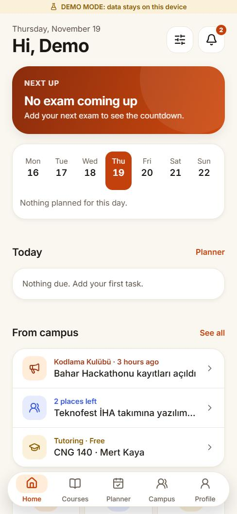
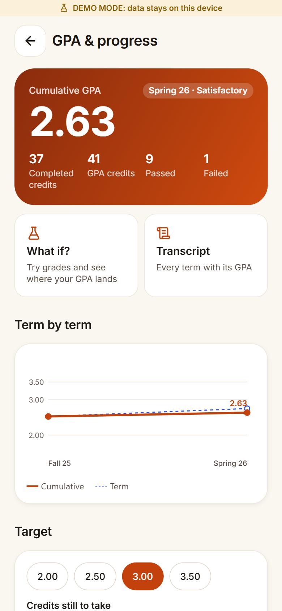
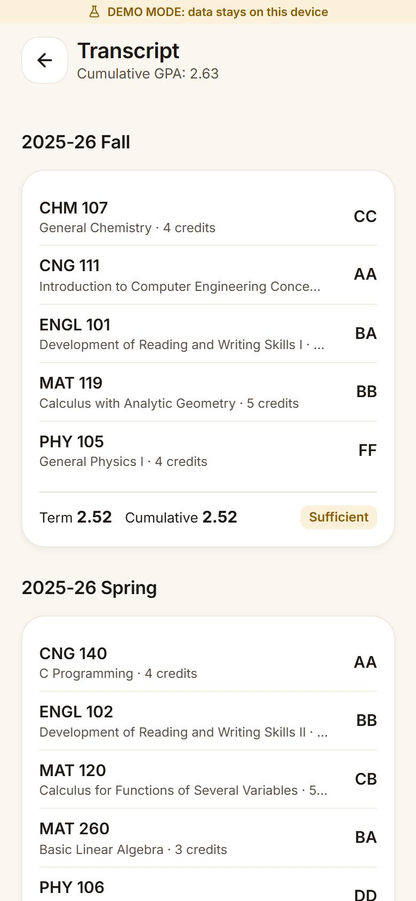
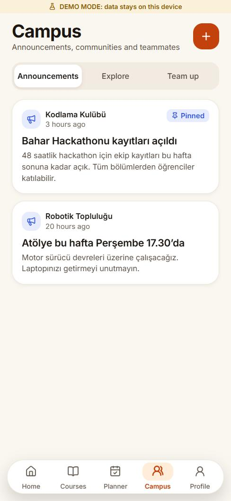

# CampusCollab

**Your courses, exams, GPA and campus life in one app, for verified students only.**

I'm a student at METU Northern Cyprus Campus. Every term I ended up juggling the same five things: an app for my timetable, a notes page for exam dates, a spreadsheet for my GPA, a dozen WhatsApp groups for clubs, and Instagram stories whenever I needed teammates for a project. So I started building one app that does all of it.

CampusCollab is a mobile app for iOS, Android and the web. It's in active development and not released yet; the first pilot is planned for METU NCC.

> This repository is a showcase. The source code is private.

  
  
  
  

Screenshots are from the app's demo mode, which runs on made-up sample data.

## What it does

### Courses and grades
- Pick your department and curriculum, and your courses come straight from the school's published catalog. No typing course names.
- A GPA screen with a term-by-term chart, your grade distribution, the courses that lift or pull your average the most, and your honour standing.
- A target calculator: "what do I need over the next 15 credits to get to 3.00?"
- A "what if" page to try grades without saving anything, including retaking an old course.
- A transcript view with the term and cumulative GPA for every term.
- The GPA math follows the actual METU regulation: NA counts like FF, the last attempt of a retaken course replaces the earlier one, W and S/U stay out of the average, and rounding is half up. It's covered by unit tests, because a GPA app that gets your GPA wrong is worse than none.

### Planning
- Tasks and exams with priorities, an exam countdown and a "next up" card.
- A focus timer (Pomodoro) with presets or your own lengths, plus a streak.
- A home screen made of widgets you can rearrange by holding one.

### Campus
- Clubs and communities post announcements to their members; each community can pin one.
- **Team up:** post that you need people for a project or a competition, and you decide who joins.
- **Tutoring:** students offer help with courses they've taken. Tutors can stay anonymous until they accept a request.

## Privacy, on purpose

- Only students with a school email can sign up.
- Nobody ever sees another student's student number, GPA or course list.
- Contact details are shared only after a request is accepted, and only the ones you chose to add.
- You can report or block anything people post, and content with enough reports is hidden automatically.
- There's no chat and no open feed. That's deliberate: fewer ways to get spammed or harassed, and more reason to keep things useful.

## How it's built

| | |
|---|---|
| App | Expo SDK 56, React Native, Expo Router, TypeScript |
| UI and state | TanStack Query, Reanimated 4, Gesture Handler, react-native-svg |
| Backend | Supabase: Postgres, Auth and row-level security |
| Testing | Database access rules tested on an in-memory Postgres (PGlite) against the real migrations; GPA engine unit tests |
| Languages | Turkish and English |

A few things I cared about:
- **Access rules live in the database.** Who can read a post, see a contact or accept a request is enforced by Postgres row-level security and server functions, not only by the app.
- **Course data is imported, never typed in.** A script reads the school's public curriculum pages and generates the catalog, so it can be refreshed every term.
- **The demo mode is a full backend of its own.** The whole app runs on local sample data, which makes it easy to try and to test.

## Status

- [x] Courses, curriculum catalog and GPA tools
- [x] Planner, exams and focus timer
- [x] Communities, announcements, Team up and tutoring
- [x] Settings, privacy controls, reports and blocking, account deletion
- [ ] Planner as a full calendar
- [ ] Push notifications and exam reminders
- [ ] Transcript import (read on the device, never uploaded)
- [ ] Pilot launch at METU NCC

## Note

CampusCollab is an independent student project. It's not affiliated with, endorsed by or connected to Middle East Technical University. Course information comes from the university's public website.

## License

Copyright (c) 2026 Baris Alkan. All rights reserved. The text and images in this repository may not be copied, modified or reused without my written permission. See [LICENSE](LICENSE).
